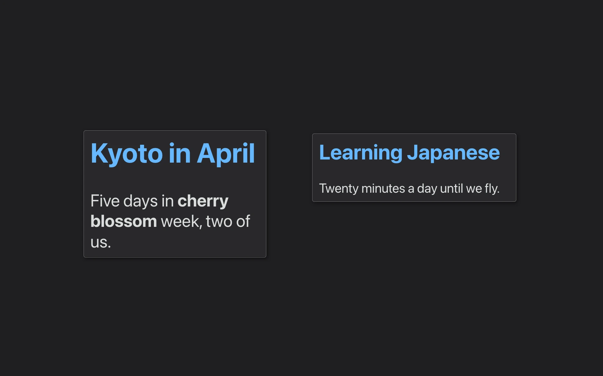
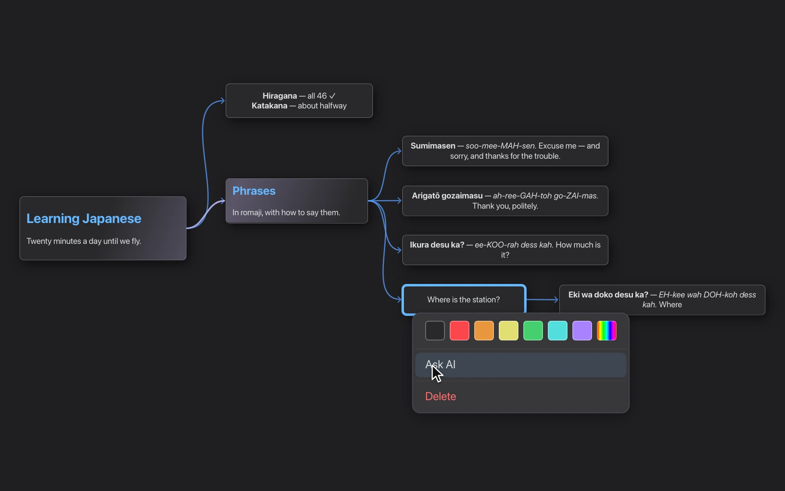
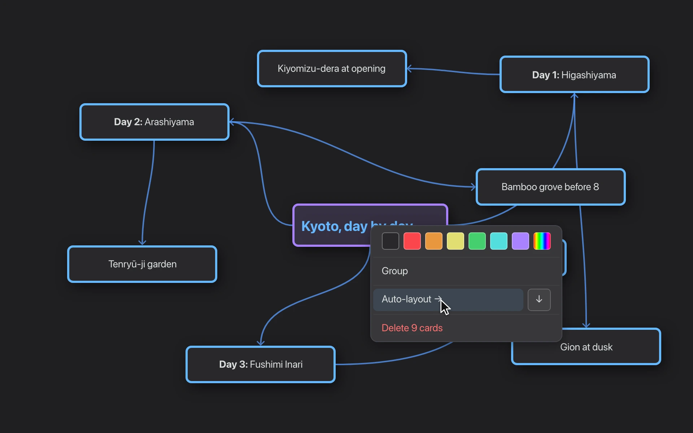
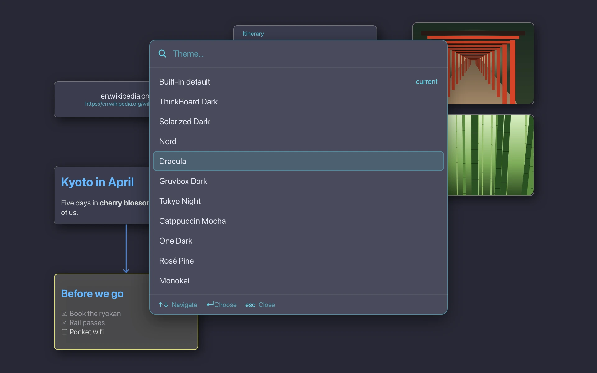

<!-- Built with the website, from its page's text and a still of each demo; edits made here are lost on the next build. -->
# ThinkBoard

Summon a board directly above your desktop with a hotkey or a gesture.

[](https://github.com/vestigecounty/thinkboard/actions/workflows/ci.yml)
&nbsp;·&nbsp; macOS · Windows · Linux &nbsp;·&nbsp; [Issues and ideas on GitHub](https://github.com/vestigecounty/thinkboard/issues) &nbsp;·&nbsp; [Chat on Discord](https://discord.gg/pNyspdkP4)

<p align="center"></p>

Similar to the old macOS Dashboard. Open your existing **Obsidian** vault's boards, or run standalone. Cards, links, Markdown and pictures, saved straight back to the `.canvas` file.

## Infinite space. Zero clutter.

Grow your board as far as you need. ThinkBoard uses smart clustering — zooming out collapses groups of cards into single, named clusters. Pinch in and the cards come back.

<p align="center"></p>

## Built for AI: the board is the prompt.

If you hook up AI, choosing *Ask AI* on any card sends the entire chain of cards leading to it as the prompt. Nothing to explain in a chat: the context is already on the board.

<p align="center"></p>

## Think messy. Tidy in one click.

Dump your thoughts on the board, then select them and choose *Auto-layout* to tidy up in left-to-right or top-to-bottom order.

Or turn on *Auto-layout* in the board's menu, and each card will place itself automatically.

<p align="center"></p>

## Make it yours, a keystroke away.

<kbd>⌘K</kbd> opens the command palette with quick access to every function and every setting. Choose from built-in themes — or let ThinkBoard pick up your vault's own Obsidian theme by itself.

<p align="center"></p>

## Features

- **Summon over anything** — An overlay above every window, on a global hotkey or a four-finger swipe. Esc puts it away.
- **Fast to build** — Drag out of a card's edge to make the next one, type Markdown in place, auto-layout to tidy.
- **Your whole vault** — <kbd>⌘O</kbd> lists every board in the vault, newest first, with fuzzy search. Its notes and pictures drop straight onto a board.
- **Command palette** — <kbd>⌘K</kbd> or <kbd>⌘P</kbd> for every action and every setting, its shortcut beside it.
- **macOS niceties** — Pinch to zoom, swipe with four fingers to summon, your wallpaper behind the board.
- **Keyboard all the way** — Arrows move between cards by where they sit, Tab adds a linked one, Enter edits.
- **Make it yours** — Ten built-in themes, previewed live — or your vault's own Obsidian theme, followed by itself.

### Plain .canvas files

Boards are Obsidian's own canvases. ThinkBoard edits them in place and keeps every field it doesn't use, so the file stays as Obsidian writes it. Keep the same board open in both: a change on either side is merged card by card, never written over, and a rename in Obsidian is followed.

`~/Vault/Trips/Kyoto.canvas`

### Ask AI

Learning Japanese → Phrases → Where is the station? → *Eki wa doko desu ka?*

Off until you choose a provider. Run a model on your own machine with LM Studio or Ollama, or paste a key for OpenAI, OpenRouter, Groq, Together AI, Fireworks AI, Mistral or DeepSeek.

## Quick start

- Press **Pause** (the default hotkey, configurable) to summon or dismiss the board — or, on a Mac, swipe down with four fingers.
- **Double-click** a card to edit it; **Esc** or **Cmd/Ctrl+Enter** when you're done.
- **Drag from a card's edge** (the little dot) onto another card to connect them, or onto empty board to make a new one.
- **Right-click** a card for actions (Ask AI, color, auto-layout for a selection…), or right-click empty space for board options like Auto-layout.
- **Cmd/Ctrl+O** switches boards: pick your vault once (**Settings → Vault**, or "Open vault…" in the command palette) and it lists every board in it. Without a vault it's the ordinary open dialog.
- **Cmd/Ctrl+K** or **Cmd/Ctrl+P** opens the command palette; **Cmd/Ctrl+F** finds text on the board; **Cmd/Ctrl+,** opens settings.
- Open or create boards — and reach **Settings** — from the tray icon.

## Install

**Prebuilt binaries** — the latest release: [macOS](https://github.com/vestigecounty/thinkboard/releases/latest/download/thinkboard-macos-universal.zip) (Universal .app), [Windows](https://github.com/vestigecounty/thinkboard/releases/latest/download/thinkboard-windows-x86_64.zip) (x86-64 .zip), [Linux](https://github.com/vestigecounty/thinkboard/releases/latest/download/thinkboard-linux-x86_64.tar.gz) (x86-64 .tar.gz). Every release is on the [Releases](https://github.com/vestigecounty/thinkboard/releases) page.

> macOS builds are unsigned, so the first launch needs a right-click → **Open** (or `xattr -dr com.apple.quarantine ThinkBoard.app`).

**From source** — with a recent Rust toolchain (2024 edition):

```sh
cargo build --release
./target/release/thinkboard
```

The patched `iced` crates it relies on are vendored in-repo, so there's nothing else to set up.

## AI setup

AI is **off by default** — nothing leaves your machine until you configure a provider. In **Settings → AI**, choose
one and, for a hosted provider, paste an API key; then pick a model from the list the provider serves. Keys are kept
per provider, so switching between them doesn't lose the others. Then right-click any card and choose **Ask AI**.

## Configuration

Tweak everything from **Settings** (the command palette, or the tray menu), or edit the config file directly:

- **macOS / Linux:** `~/.config/thinkboard/config.json`
- **Windows:** `%APPDATA%\thinkboard\config.json`

## License

Released under the [MIT License](LICENSE).
