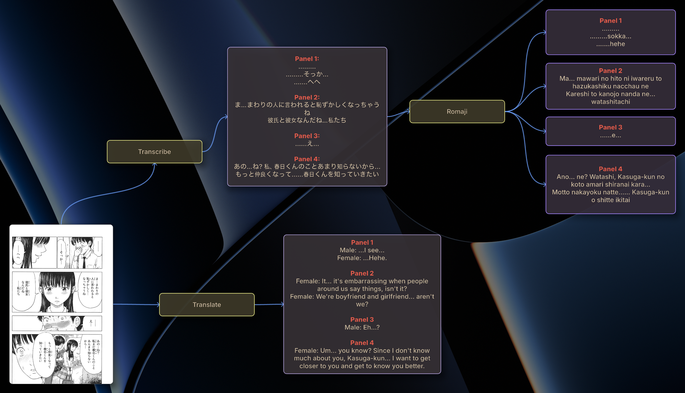

# ThinkBoard

**Create and edit Obsidian canvases in a Dashboard-style overlay, summoned with a global hotkey.**

[](https://github.com/vestigecounty/thinkboard/actions/workflows/ci.yml)
&nbsp;·&nbsp; macOS · Windows · Linux

<p align="center">
  
</p>

ThinkBoard is a lightweight desktop overlay for thinking in maps. Hit a hotkey and
your canvas floats in over whatever you're doing — even a fullscreen app — so you
can jot a thought, branch an idea, or ask an AI to expand it, then tuck it away just
as fast. It reads and writes Obsidian `.canvas` files, so your boards can live right
in your vault.

## Features

- **Summon over anything** — a translucent, always-on-top overlay that drops onto your current desktop (even over fullscreen apps) with a global hotkey, and toggles away with the same key.
- **Obsidian-compatible** — opens and saves standard `.canvas` files; pick up your vault's canvases or start fresh ones.
- **Your whole vault** — point it at your Obsidian vault and **Cmd/Ctrl+O** lists every board in it, newest first, with fuzzy search by name. Boards from anywhere else still open by dialog or drag-and-drop.
- **Fast to build** — create cards, drag from a card's edge to connect them, double-click to edit Markdown, and auto-layout to tidy the whole board.
- **Ask AI (optional)** — right-click a card and the chain of cards leading into it becomes the prompt; the reply lands as new, connected cards. Off by default.
- **Make it yours** — ten built-in schemes (Solarized, Nord, Dracula, Gruvbox, Tokyo Night, Catppuccin, One Dark, Rosé Pine, Monokai), picked from the command palette with the board previewing each as you scroll. Drop your own in the themes folder, or set your vault and take on whichever theme Obsidian is using.
- **macOS niceties** — pinch-to-zoom, plus an optional four-finger-swipe-down summon gesture.

## Quick start

- Press **Pause** (the default hotkey, configurable) to summon or dismiss the board.
- **Double-click** a card to edit it; **Esc** or **Cmd/Ctrl+Enter** when you're done.
- **Drag from a card's edge** (the little dot) onto another card to connect them.
- **Right-click** a card for actions (Ask AI, color…), or right-click empty space for board options like Auto-layout.
- **Cmd/Ctrl+O** switches boards: pick your vault once (**Settings → Vault**, or "Open vault…" in the command palette) and it lists every board in it. Without a vault it's the ordinary open dialog.
- **Cmd/Ctrl+K** or **Cmd/Ctrl+P** opens the command palette; **Cmd/Ctrl+F** finds text on the board; **Cmd/Ctrl+,** opens settings.
- **"Change theme"** in the palette lists every theme — arrow through them and the board changes under the panel; Enter keeps one, Esc puts back what you had.
- Open or create boards — and reach **Settings** — from the tray icon.

## Install

**Prebuilt binaries** — grab the latest from [Releases](../../releases): a universal macOS `.app`, a Windows `.zip`, or a Linux `.tar.gz`.

> macOS builds are unsigned, so the first launch needs a right-click → **Open** (or `xattr -dr com.apple.quarantine ThinkBoard.app`).

**From source** — with a recent Rust toolchain (2024 edition):

```sh
cargo build --release
./target/release/thinkboard
```

The patched `iced` crates it relies on are vendored in-repo, so there's nothing else to set up.

## AI setup

AI is **off by default** — nothing leaves your machine until you configure a provider.
In **Settings → AI**, choose one and (for hosted providers) paste an API key.
Keys are kept per provider, so switching between them doesn't lose the others:

- **Local:** LM Studio, Ollama
- **Hosted:** OpenAI, OpenRouter, Groq, Together AI, Fireworks AI, Mistral, DeepSeek

Then right-click any card and choose **Ask AI**.

## Configuration

Tweak everything from the tray menu's **Settings**, or edit the config file directly:

- **macOS / Linux:** `~/.config/thinkboard/config.json`
- **Windows:** `%APPDATA%\thinkboard\config.json`

## License

Released under the [MIT License](LICENSE).
